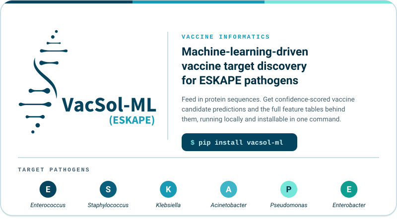
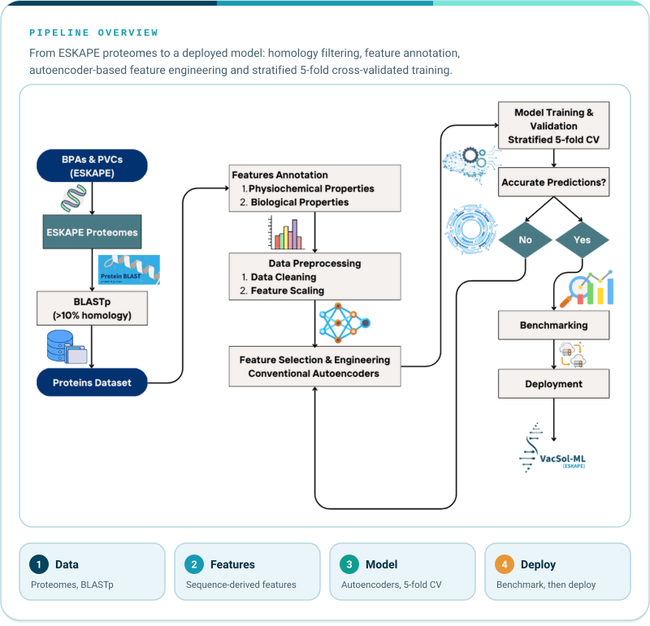

<div align="center">



<a href="https://pypi.org/project/vacsol-ml/"></a>
<a href="https://doi.org/10.1016/j.vaccine.2024.126204"></a>
<a href="#quick-start"></a>
<a href="mailto:samavi.nasir@gmail.com"></a>

</div>

<a id="overview"></a>
<h2></h2>

**VacSol-ML(ESKAPE)** is a machine learning-driven framework for **vaccine target discovery**, built to analyze and prioritize candidate proteins from **ESKAPE pathogens**. It integrates bioinformatics feature extraction with trained machine-learning models, so researchers can identify promising vaccine candidates in a reproducible and scalable way.

```bash
pip install vacsol-ml
```

<a id="why-it-matters"></a>
<h2></h2>

The ESKAPE group (*Enterococcus faecium*, *Staphylococcus aureus*, *Klebsiella pneumoniae*, *Acinetobacter baumannii*, *Pseudomonas aeruginosa*, and *Enterobacter* spp.) is responsible for a large proportion of antimicrobial-resistant infections worldwide. As antibiotics lose effectiveness, **vaccines are one of the most promising ways to reduce infections and slow the spread of resistance**, but choosing which of thousands of proteins to test is slow and expensive.

VacSol-ML addresses this bottleneck by combining:

| | Ingredient | What it brings |
|---|---|---|
| 🧬 | **Sequence-derived features** | Biological, immunological and physicochemical descriptors computed directly from protein sequences. |
| 🤖 | **Machine-learning classification** | Trained models that separate vaccine candidates from non-candidates. |
| 📊 | **Confidence scoring** | Every prediction comes with a model confidence score, so candidates can be ranked and triaged. |

The result is a shortlist of proteins worth taking into the lab, **before** committing experimental resources.

<a id="workflow"></a>
<h2></h2>

<p align="center">
  
</p>

**Under the hood.** The published framework was built on **3,650+ engineered sequence features** and **seven machine-learning algorithms** evaluated with stratified 5-fold cross-validation, then tested on an independent benchmark dataset. See the [paper](https://doi.org/10.1016/j.vaccine.2024.126204) for the full methodology and results.

<a id="key-features"></a>
<h2></h2>

| | Feature | Description |
|---|---|---|
| 🧬 | **Protein-level prediction** | Vaccine target prediction for individual protein sequences from ESKAPE pathogens. |
| 🤖 | **ML classification pipeline** | An end-to-end pipeline from raw sequences to classified candidates. |
| 📊 | **Confidence scoring** | A model confidence score accompanies each prediction. |
| 🖥️ | **Descriptor extraction** | Immunological and physicochemical descriptors of the input sequences, available to download. |
| 🌐 | **Local web interface** | Upload, configure, run and download results in your browser, served from your own machine. |
| 📦 | **One-command install** | Distributed as a pip-installable package on PyPI. |

<a id="quick-start"></a>
<h2></h2>

**Requirements:** Python `>=3.10, <3.13`

```bash
# 1. Install (a virtual environment is recommended)
pip install vacsol-ml

# 2. Initialize the internal database
vacsol-ml migrate

# 3. Launch the local web interface
vacsol-ml web
```

Then open **http://127.0.0.1:8000/** in your browser and:

1. Upload or select protein sequence data
2. Configure the analysis parameters
3. Run the ML-based vaccine target prediction pipeline
4. View and download the results directly from the interface

> **Notes**
> - TensorFlow is a required dependency and is installed automatically, so the first install can take a while depending on your system and connection.
> - The web interface is intended for local or server-based use. It is not recommended for Google Colab or notebook environments.

<a id="input-output"></a>
<h2></h2>

**Input:** protein sequences in FASTA format, one protein per entry.

```
>Protein_1
MKKLLPTAAAGLLLLAAQPAMA...
```

**Output:** tabular results containing

- **Protein ID**
- **Predicted class** (Vaccine Candidate / Non-candidate)
- **Model confidence score**
- **Downloadable datasets** of the immunological and physicochemical features for your input sequences

<a id="who-its-for"></a>
<h2></h2>

| | Audience | How VacSol-ML helps |
|---|---|---|
| 🎓 | **Academic researchers and students** | A reproducible, citable starting point for reverse vaccinology and antigen prediction on ESKAPE pathogens. |
| 🏢 | **Biotech and vaccine developers** | Triage large protein sets into ranked, confidence-scored shortlists before wet-lab work. |
| 🔬 | **Bioinformatics cores and CROs** | A packaged, installable tool with a web interface, so teams can run analyses without building a pipeline from scratch. |

**Built for real-world use**

- **Runs locally.** Analyses run on your own machine or server through a local web interface.
- **Reproducible and scalable.** A packaged framework with versioned releases on PyPI, instead of a collection of scripts.
- **Permissive license.** Released under the MIT License.

**Open to collaboration.** I'm interested in research collaborations and industry partnerships around vaccine informatics and machine learning for infectious disease. [Get in touch](mailto:samavi.nasir@gmail.com).

<a id="ecosystem"></a>
<h2></h2>

VacSol-ML is part of a growing set of open tools for computational vaccine and antimicrobial discovery.

| Project | Description |
|---|---|
| **VacSol-ML** (this repository) | ML framework for vaccine target discovery in ESKAPE pathogens. |
| [**ProteoAnnot**](https://github.com/samavinasir/proteoannot) | Standalone protein annotation package extracted from the VacSol-ML annotation engine, computing biological and physicochemical features from FASTA sequences. |
| [**ESKAPE AMP Database**](https://github.com/samavinasir?tab=repositories) | ESKAPE pathogen-targeted antimicrobial peptide database. |
| [**B-vac**](https://samavinasir.github.io/b-vac/) | Desktop application for reverse-vaccinology-based bacterial vaccine candidate discovery. |
| **B-vac.AI** | Agentic AI for vaccine development (Coming Soon). |

<a id="citation"></a>
<h2></h2>

If you use VacSol-ML in your research, please cite the associated publication:

> **VacSol-ML(ESKAPE): Machine learning empowering vaccine antigen prediction for ESKAPE pathogens.** *Vaccine* (2024). DOI: [10.1016/j.vaccine.2024.126204](https://doi.org/10.1016/j.vaccine.2024.126204)

<a id="author"></a>
<h2></h2>

**Samavi Nasir**: AI Engineer · Bioinformatician · Machine Learning Researcher
MSc Industrial Biotechnology, Atta-ur-Rahman School of Applied Biosciences (ASAB), National University of Sciences and Technology (NUST), Islamabad, Pakistan.

- 📧 **Email:** [samavi.nasir@gmail.com](mailto:samavi.nasir@gmail.com)
- 🎓 **Google Scholar:** [Samavi Nasir](https://scholar.google.com/citations?hl=en&user=K_okdSMAAAAJ)
- 💼 **LinkedIn:** [linkedin.com/in/samavinasir](https://pk.linkedin.com/in/samavinasir)
- 💻 **GitHub:** [@samavinasir](https://github.com/samavinasir)

<a id="license"></a>
<h2></h2>

This project is released under the **MIT License**. See the [LICENSE](LICENSE) file for details.

> **Disclaimer.** VacSol-ML(ESKAPE) is intended for **research purposes only**. It provides *in silico* predictions to support vaccine target identification. These predictions require downstream experimental validation before clinical translation.

**Contributing.** Contributions, bug reports and feature requests are welcome. Please open an issue or submit a pull request.

---

<div align="center">

**Machine learning for the vaccines the antibiotic era is running out of.**

VacSol-ML(ESKAPE) · Reverse Vaccinology · NUST Islamabad

</div>
